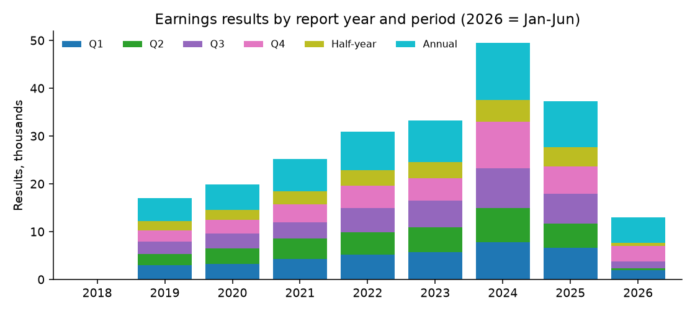
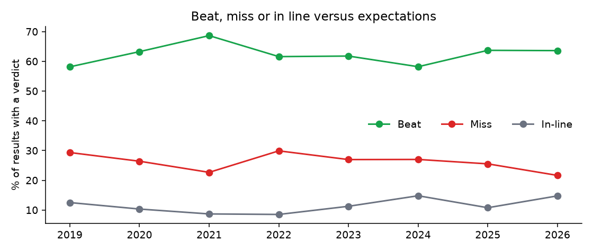
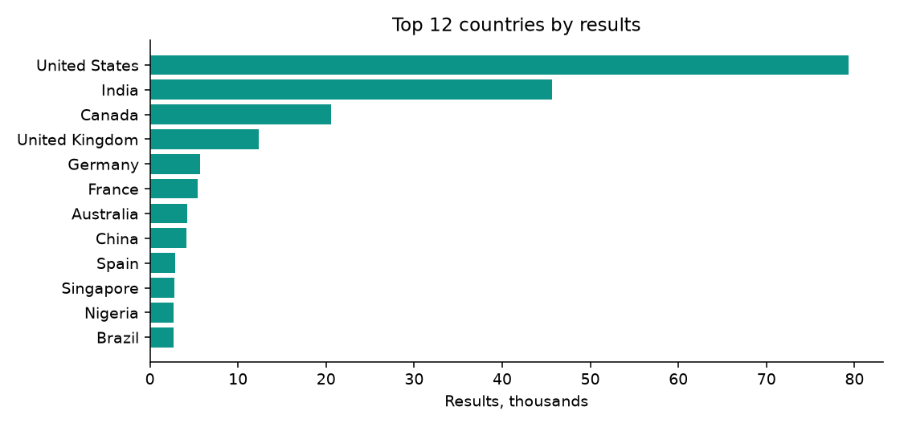

# Company Earnings Results 2019–2026: findings, method and data card

*Fliar Research · released October 2026 · licence CC BY-NC 4.0*

**How this dataset was acquired.** Every row comes from the [Radar API](https://github.com/fliarbi/radar-api-mcp), Fliar's company-data API and MCP server. Radar reads
business news continuously and extracts each reported earnings result into structured fields: company, period, fiscal year,
currency, revenue, net income, earnings per share, growth and whether the result beat or missed expectations. It links the company to
its website in a database of five million companies. This release covers results first reported between January 2019 and June 2026.
It runs that output through a reproducible cleaning pipeline: repeated reports of the same result are merged into one row, forecasts
and previews are dropped, and each figure is checked against the sentence it was read from. Each row names the article it was read
from (`news_source`, `news_url`) and quotes the sentence (`news_excerpt`). The full, continuously updated event history, including
guidance and every reporting article, is available through `POST /v1/companies/events` ([reference](https://github.com/fliarbi/radar-api-mcp/blob/main/docs/reference/get_company_events.md)) or the
`get_company_events` MCP tool.

> **This file is a 25% sample: 56,464 of 225,779 earnings results.** It keeps every record for a fixed subset of companies.
> The subset is chosen by a hash, so it stays the same from one release to the next. The findings and tables below were computed
> on the **full** data. For the rest, the withheld fields and monthly updates, [get a Radar API key](https://fliarbi.com/radar-api/developer) ([docs](https://github.com/fliarbi/radar-api-mcp)).
> Each row's `fliar_profile_url` opens the company's full profile on Fliar.

## Key findings

1. **225,779 earnings results for 33,900 companies, reported in the news between January 2019 and June 2026.** 60,163 are full-year results, 142,897 quarterly and 22,719 half-year.
2. **35,956 results say how they compared with analyst expectations: 62% beat, 27% missed and 11% were in line.**
3. **Coverage is led by United States (79,283 results), India (45,650) and Canada (20,556)**, with 152 countries in all.
4. **Median reported full-year revenue growth** (results with US$100M+ revenue): fiscal 2019 +7.0%, fiscal 2020 +3.7%, fiscal 2021 +16.3%, fiscal 2022 +17.0%, fiscal 2023 +10.0%, fiscal 2024 +7.0%, fiscal 2025 +7.8%.
5. **28% of quarterly results with a net-income figure were losses**, from 20% (2026) to 37% (2020) by year.
6. **83% of results carry a revenue or profit figure that was found again in the reporting sentence**; 3.7% had a figure blanked because it failed the check.

### Results by report year and period type

Full data, by the year the result was first reported.

| Report year    | Q1    | Q2    | Q3    | Q4    | Half-year   | Annual   | All    | Companies   | With beat/miss   |
|:---------------|:------|:------|:------|:------|:------------|:---------|:-------|:------------|:-----------------|
| 2018           | 0     | 0     | 0     | 0     | 0           | 2        | 2      | 2           | 0                |
| 2019           | 3,023 | 2,248 | 2,638 | 2,368 | 1,865       | 4,895    | 17,037 | 8,166       | 2,942            |
| 2020           | 3,249 | 3,235 | 3,171 | 2,795 | 2,155       | 5,230    | 19,835 | 8,893       | 2,556            |
| 2021           | 4,246 | 4,260 | 3,443 | 3,812 | 2,715       | 6,685    | 25,161 | 11,061      | 3,697            |
| 2022           | 5,243 | 4,575 | 5,080 | 4,766 | 3,196       | 8,049    | 30,909 | 12,645      | 6,074            |
| 2023           | 5,724 | 5,124 | 5,617 | 4,695 | 3,449       | 8,622    | 33,231 | 13,747      | 6,130            |
| 2024           | 7,775 | 7,140 | 8,359 | 9,741 | 4,545       | 11,872   | 49,432 | 17,499      | 5,765            |
| 2025           | 6,598 | 5,140 | 6,196 | 5,653 | 4,068       | 9,578    | 37,233 | 15,073      | 6,962            |
| 2026 (Jan–Jun) | 1,910 | 392   | 1,454 | 3,227 | 726         | 5,230    | 12,939 | 8,386       | 1,830            |

### Beat, miss or in line by report year

| Report year   | Results with a verdict   | Beat   | Miss   | In line   | Beat, quarterly only   |
|:--------------|:-------------------------|:-------|:-------|:----------|:-----------------------|
| 2019          | 2,942                    | 58.2%  | 29.3%  | 12.5%     | 60.8%                  |
| 2020          | 2,556                    | 63.3%  | 26.4%  | 10.3%     | 65.7%                  |
| 2021          | 3,697                    | 68.7%  | 22.7%  | 8.7%      | 69.9%                  |
| 2022          | 6,074                    | 61.6%  | 29.9%  | 8.5%      | 61.9%                  |
| 2023          | 6,130                    | 61.8%  | 27.0%  | 11.3%     | 62.9%                  |
| 2024          | 5,765                    | 58.2%  | 27.0%  | 14.8%     | 60.1%                  |
| 2025          | 6,962                    | 63.7%  | 25.5%  | 10.8%     | 65.8%                  |
| 2026          | 1,830                    | 63.6%  | 21.6%  | 14.8%     | 66.2%                  |

### Beat and miss rates by sector (top 30 sectors by results with a verdict)

Sectors with at least 100 results that state a verdict.

| Sector                              | Results   | Companies   | Beat   | Miss   | In line   |
|:------------------------------------|:----------|:------------|:-------|:-------|:----------|
| Retail                              | 1,713     | 254         | 62.9%  | 27.5%  | 9.6%      |
| Financial Services                  | 1,704     | 453         | 64.3%  | 25.5%  | 10.2%     |
| IT Services                         | 1,565     | 297         | 64.5%  | 22.7%  | 12.8%     |
| Software                            | 1,462     | 271         | 78.7%  | 15.1%  | 6.2%      |
| Pharmaceuticals                     | 1,396     | 304         | 57.7%  | 31.4%  | 10.8%     |
| Biotechnology                       | 1,353     | 472         | 59.0%  | 33.3%  | 7.8%      |
| Internet                            | 1,351     | 218         | 73.0%  | 21.0%  | 6.0%      |
| Medical devices                     | 1,323     | 204         | 67.9%  | 24.8%  | 7.3%      |
| Banking                             | 1,313     | 340         | 64.2%  | 27.8%  | 8.0%      |
| Oil & Gas                           | 1,281     | 325         | 58.0%  | 31.8%  | 10.2%     |
| Automotive                          | 1,222     | 245         | 56.5%  | 31.7%  | 11.8%     |
| Consumer Goods                      | 854       | 129         | 58.0%  | 28.1%  | 13.9%     |
| Telecommunications                  | 838       | 208         | 54.7%  | 23.7%  | 21.6%     |
| Semiconductors                      | 791       | 110         | 77.9%  | 13.4%  | 8.7%      |
| Electrical/electronic manufacturing | 746       | 157         | 63.7%  | 23.7%  | 12.6%     |
| Mining                              | 689       | 191         | 51.1%  | 32.9%  | 16.0%     |
| Real Estate                         | 661       | 218         | 59.9%  | 24.8%  | 15.3%     |
| Food & beverages                    | 655       | 121         | 59.1%  | 30.1%  | 10.8%     |
| Healthcare                          | 654       | 149         | 68.7%  | 22.3%  | 9.0%      |
| Apparel & fashion                   | 553       | 84          | 66.0%  | 25.3%  | 8.7%      |
| Renewables & environment            | 503       | 123         | 51.9%  | 33.4%  | 14.7%     |
| Insurance                           | 476       | 147         | 64.3%  | 27.1%  | 8.6%      |
| Entertainment                       | 456       | 83          | 61.4%  | 28.5%  | 10.1%     |
| Chemicals                           | 420       | 121         | 54.5%  | 34.0%  | 11.4%     |
| Utilities                           | 407       | 100         | 57.7%  | 28.3%  | 14.0%     |
| Construction                        | 388       | 121         | 54.1%  | 28.6%  | 17.3%     |
| Airlines                            | 331       | 65          | 59.8%  | 28.4%  | 11.8%     |
| Building materials                  | 327       | 81          | 53.2%  | 30.9%  | 15.9%     |
| Food production                     | 320       | 73          | 65.0%  | 24.7%  | 10.3%     |
| Transportation/trucking/railroad    | 317       | 67          | 56.5%  | 34.1%  | 9.5%      |

### Largest companies by latest full-year revenue (top 50, fiscal 2024 or later)

Each company's most recent full-year result whose revenue figure was confirmed in the reporting sentence. Figures are as reported; some articles quote group or gross revenue.

| #   | Company                            | Fiscal year   | Revenue (US$)   | Net income (US$)   | Net margin   | Reported growth   | Country        | Sector                       |
|:----|:-----------------------------------|:--------------|:----------------|:-------------------|:-------------|:------------------|:---------------|:-----------------------------|
| 1   | Amazon                             | 2024          | $638.0B         | $59.2B             | 9.3%         | +8.6%             | United States  | Internet                     |
| 2   | Apple                              | 2025          | $416.2B         | $112.0B            | 26.9%        | +19.9%            | United States  | Consumer electronics         |
| 3   | CVS Health                         | 2026          | $400.0B         |                    |              |                   | United States  | Pharmaceuticals              |
| 4   | PetroChina                         | 2025          | $398.2B         | $21.9B             | 5.5%         | -2.5%             | China          | Oil & Gas                    |
| 5   | Volkswagen Group                   | 2024          | $353.6B         |                    |              | +0.7%             | Germany        | Automotive                   |
| 6   | Alphabet                           | 2024          | $350.0B         | $100.0B            | 28.6%        | +14.0%            | United States  | Consumer services            |
| 7   | Vitol                              | 2024          | $331.0B         |                    |              | -17.9%            | United Kingdom | Oil & Gas                    |
| 8   | UnitedHealthcare                   | 2024          | $298.2B         |                    |              | +6.0%             | United States  | Insurance                    |
| 9   | Toyota                             | 2025          | $297.0B         | $32.3B             | 10.9%        | +21.0%            | Japan          | Automotive                   |
| 10  | Cencora                            | 2024          | $294.0B         | $1.5B              | 0.5%         | +12.1%            | United States  | Healthcare                   |
| 11  | Shell                              | 2024          | $289.0B         | $16.1B             | 5.6%         | -11.0%            | United Kingdom | Oil & Gas                    |
| 12  | Microsoft                          | 2025          | $281.7B         | $101.8B            | 36.1%        | +15.0%            | United States  | Software                     |
| 13  | Optum                              | 2025          | $270.6B         |                    |              | +7.0%             | United States  | Healthcare                   |
| 14  | Costco                             | 2025          | $269.9B         |                    |              | +8.1%             | United States  | Retail                       |
| 15  | Foxconn                            | 2025          | $251.1B         | $5.9B              | 2.3%         | +18.0%            | Taiwan         | Consumer electronics         |
| 16  | Cigna                              | 2024          | $247.1B         | $3.4B              | 1.4%         | +27.0%            | United States  | Health, wellness and fitness |
| 17  | Samsung                            | 2024          | $218.1B         |                    |              | +15.9%            | South Korea    | Consumer electronics         |
| 18  | Nvidia                             | 2026          | $215.9B         | $120.1B            | 55.6%        | +65.0%            | United States  | Computer hardware            |
| 19  | Meta                               | 2025          | $201.0B         |                    |              | +22.0%            | United States  | Consumer electronics         |
| 20  | Elevance                           | 2025          | $198.0B         | $5.6B              | 2.8%         | +13.0%            | United States  | Health Insurance             |
| 21  | Centene                            | 2025          | $194.8B         | $3.3B              | 1.7%         | +20.0%            | United States  | Healthcare                   |
| 22  | Allianz                            | 2024          | $194.2B         | $10.7B             | 5.5%         | +11.2%            | Germany        | Insurance                    |
| 23  | Ford Motor Company                 | 2024          | $185.0B         | $5.9B              | 3.2%         | +5.0%             | United States  | Retail                       |
| 24  | The Home Depot                     | 2026          | $163.9B         |                    |              |                   | United States  | Retail                       |
| 25  | Mercedes-Benz                      | 2024          | $157.2B         | $11.2B             | 7.1%         | -4.0%             | Germany        | Automotive                   |
| 26  | Trip.Jd.com                        | 2025          | $157.1B         |                    |              | +10.9%            | China          | Internet                     |
| 27  | Kroger                             | 2024          | $147.1B         |                    |              |                   | United States  | Supermarkets                 |
| 28  | China Mobile                       | 2025          | $146.0B         | $19.1B             | 13.1%        | +0.9%             | China          | Telecommunications           |
| 29  | Phillips 66                        | 2024          | $145.5B         | $2.1B              | 1.5%         | -11.3%            | United States  | Financial Services           |
| 30  | BMW Group                          | 2025          | $143.6B         | $11.1B             | 7.7%         | +0.5%             | Germany        | Executive office             |
| 31  | Honda                              | 2025          | $143.2B         | $5.5B              | 3.9%         | +6.2%             | Japan          | Automotive                   |
| 32  | Walgreens Boots Alliance           | 2024          | $139.1B         | $230.0M            | 0.2%         | +6.2%             | United States  | Pharmaceuticals              |
| 33  | Alibaba Group                      | 2025          | $138.1B         | $17.9B             | 13.0%        | +6.0%             | China          | IT Services                  |
| 34  | Verizon                            | 2024          | $134.8B         |                    |              | +0.6%             | United States  | IT Services                  |
| 35  | State Farm                         | 2025          | $132.3B         | $12.9B             | 9.8%         | +7.5%             | United States  | Insurance                    |
| 36  | Deutsche Telekom                   | 2025          | $128.6B         | $10.5B             | 8.2%         | +4.2%             | Germany        | Telecommunications           |
| 37  | EDF                                | 2024          | $128.2B         | $12.3B             | 9.6%         | -15.7%            | France         | Oil & Gas                    |
| 38  | AXA                                | 2025          | $125.3B         | $9.1B              | 7.2%         | +6.0%             | France         | Multi-line insurance         |
| 39  | Comcast                            | 2024          | $123.7B         |                    |              | +1.8%             | United States  | Media production             |
| 40  | Huawei                             | 2025          | $123.2B         | $68.0B             | 55.2%        | +2.2%             | China          | Telecommunications           |
| 41  | At&T                               | 2024          | $122.3B         | $12.3B             | 10.1%        | -0.1%             | United States  | Telecommunications           |
| 42  | Gazprom                            | 2024          | $117.7B         | $13.4B             | 11.4%        | +25.0%            | Russia         | Oil & Gas                    |
| 43  | Kaiser Permanente                  | 2024          | $115.8B         | $12.9B             | 11.1%        | +15.0%            | United States  | Healthcare                   |
| 44  | Google                             | 2025          | $113.8B         |                    |              | +17.0%            | United States  | Internet                     |
| 45  | Dell Technologies                  | 2026          | $113.5B         | $5.9B              | 5.2%         | +19.0%            | United States  | IT Services                  |
| 46  | REWE                               | 2025          | $108.0B         | $567.0M            | 0.5%         | +4.0%             | Germany        | Retail                       |
| 47  | Taiwan Semiconductor Manufacturing | 2025          | $107.6B         |                    |              | +32.8%            | Taiwan         | Semiconductors               |
| 48  | BYD                                | 2024          | $107.2B         | $40.3B             | 37.6%        | +29.0%            | China          | Automotive                   |
| 49  | Target                             | 2025          | $104.8B         |                    |              | -1.7%             | United States  | Retail                       |
| 50  | Tencent                            | 2025          | $104.5B         | $36.1B             | 34.5%        | +14.0%            | China          | Internet                     |

### Fastest full-year revenue growth (top 50, prior-year revenue ≥ US$1B, fiscal 2023 or later)

Computed from two consecutive full-year results of the same company in the same currency, kept only when it agrees (within 3 points) with the growth the later article reported. Jumps can include acquisitions.

| #   | Company                       | Fiscal year   | Prior-year revenue   | Revenue   | Growth   | Country              | Sector                              |
|:----|:------------------------------|:--------------|:---------------------|:----------|:---------|:---------------------|:------------------------------------|
| 1   | Venture Global                | 2025          | $5.0B                | $13.8B    | 177.6%   | United States        | Automotive                          |
| 2   | Hanwha Aerospace              | 2025          | $8.2B                | $19.4B    | 136.7%   | South Korea          | Aviation & aerospace                |
| 3   | Nvidia                        | 2024          | $27.0B               | $60.9B    | 125.6%   | United States        | Computer hardware                   |
| 4   | Hays Travel                   | 2023          | $1.4B                | $2.8B     | 104.7%   | United Kingdom       | Leisure, travel & tourism           |
| 5   | Argenx                        | 2025          | $2.2B                | $4.2B     | 89.9%    | Netherlands          | Biotechnology                       |
| 6   | Cal-Maine Foods               | 2025          | $2.3B                | $4.3B     | 87.0%    | United States        | Food production                     |
| 7   | Prestige Estates              | 2026          | $2.0B                | $3.6B     | 76.4%    | India                | Real Estate                         |
| 8   | Wynn Resorts                  | 2023          | $3.8B                | $6.5B     | 73.7%    | United States        | Hospitality                         |
| 9   | Revolut                       | 2024          | $2.3B                | $4.0B     | 72.2%    | United Kingdom       | IT Services                         |
| 10  | Reddit                        | 2025          | $1.3B                | $2.2B     | 69.2%    | United States        | Online media                        |
| 11  | Futu Holdings                 | 2025          | $1.8B                | $2.9B     | 68.0%    | United States        | Financial Services                  |
| 12  | Nintendo                      | 2026          | $7.7B                | $12.5B    | 63.8%    | Japan                | Computer games                      |
| 13  | Unity                         | 2023          | $1.4B                | $2.2B     | 56.4%    | United Kingdom       | Banking                             |
| 14  | Astrana Health                | 2025          | $2.0B                | $3.2B     | 56.4%    | United States        | Healthcare                          |
| 15  | Palantir                      | 2025          | $2.9B                | $4.5B     | 55.9%    | United States        | Software                            |
| 16  | Coromandel International      | 2023          | $2.3B                | $3.6B     | 55.0%    | India                | Chemicals                           |
| 17  | Symbotic                      | 2024          | $1.2B                | $1.8B     | 54.8%    | United States        | Industrial automation               |
| 18  | MTN Nigeria Communications    | 2025          | $2.3B                | $3.5B     | 54.8%    | Nigeria              | Telecommunications                  |
| 19  | CrowdStrike                   | 2023          | $1.4B                | $2.2B     | 54.5%    | United States        | Computer & network security         |
| 20  | International Holding Company | 2024          | $16.3B               | $25.2B    | 54.3%    | United Arab Emirates | Other commercial services           |
| 21  | Whitecap Resources            | 2025          | $2.7B                | $4.1B     | 53.7%    | Canada               | Oil & Gas                           |
| 22  | United Bank for Africa        | 2024          | $1.4B                | $2.2B     | 53.4%    | Nigeria              | Banking                             |
| 23  | Cincinnati                    | 2023          | $6.6B                | $10.0B    | 52.7%    | United States        | Insurance                           |
| 24  | Robinhood                     | 2025          | $3.0B                | $4.5B     | 52.5%    | United States        | Food & beverages                    |
| 25  | BeiGene                       | 2024          | $2.5B                | $3.8B     | 52.4%    | United States        | Biotechnology                       |
| 26  | ACCIONA                       | 2023          | $12.1B               | $18.4B    | 52.0%    | Spain                | Renewables & environment            |
| 27  | Amphenol                      | 2025          | $15.2B               | $23.1B    | 51.7%    | United States        | Electrical/electronic manufacturing |
| 28  | Trinity Industries            | 2023          | $2.0B                | $3.0B     | 50.0%    | United States        | Transportation/trucking/railroad    |
| 29  | Invictus                      | 2025          | $2.4B                | $3.6B     | 49.4%    | United Arab Emirates | Holding companies                   |
| 30  | Micron                        | 2025          | $27.8B               | $41.5B    | 49.0%    | United States        | Semiconductors                      |
| 31  | City Developments             | 2023          | $2.5B                | $3.7B     | 48.5%    | Singapore            | Real Estate                         |
| 32  | Max Financial Services        | 2024          | $3.8B                | $5.6B     | 48.3%    | India                | Insurance                           |
| 33  | Brookfield                    | 2024          | $1.8B                | $2.7B     | 46.5%    | Canada               | Farming                             |
| 34  | Pacific Aluminium             | 2025          | $1.0B                | $1.5B     | 46.1%    | New Zealand          | Aluminum mining                     |
| 35  | Sunrun                        | 2025          | $2.0B                | $3.0B     | 45.3%    | United States        | Renewables & environment            |
| 36  | Emaar Development             | 2025          | $5.2B                | $7.5B     | 44.0%    | United Arab Emirates | Construction                        |
| 37  | DraftKings                    | 2023          | $2.0B                | $2.9B     | 43.6%    | United States        | Internet                            |
| 38  | Changi Airport                | 2024          | $1.4B                | $2.0B     | 43.5%    | Singapore            | Airlines                            |
| 39  | Applovin                      | 2024          | $3.3B                | $4.7B     | 42.4%    | United States        | Marketing and advertising           |
| 40  | Marvell                       | 2026          | $5.8B                | $8.2B     | 42.1%    | United States        | Semiconductors                      |
| 41  | Beijer Ref                    | 2023          | $2.2B                | $3.1B     | 42.0%    | Sweden               | Wholesale                           |
| 42  | Adani Energy Solutions        | 2025          | $2.1B                | $2.9B     | 42.0%    | India                | Electric utilities                  |
| 43  | Sonoco                        | 2025          | $5.3B                | $7.5B     | 41.4%    | United States        | Packaging and containers            |
| 44  | Royal Enfield                 | 2023          | $1.2B                | $1.7B     | 40.2%    | India                | Automotive                          |
| 45  | Cameco                        | 2023          | $1.4B                | $1.9B     | 38.7%    | Canada               | Mining                              |
| 46  | Avenue                        | 2023          | $3.7B                | $5.1B     | 38.3%    | India                | Apparel & fashion                   |
| 47  | Innovent Bio                  | 2025          | $1.3B                | $1.8B     | 38.0%    | China                | Pharmaceuticals                     |
| 48  | Bloom Energy                  | 2025          | $1.5B                | $2.0B     | 37.2%    | United States        | Oil & Gas                           |
| 49  | LPL Financial                 | 2025          | $12.4B               | $17.0B    | 37.2%    | United States        | Financial Services                  |
| 50  | Capital One                   | 2025          | $39.1B               | $53.4B    | 36.6%    | United States        | Financial Services                  |

### Results by country (top 30)

Beat rate shown where at least 30 results state a verdict.

| #   | Country              | Results   | Companies   | Quarterly share   | Median revenue per result (US$)   | Loss-making share   | Beat rate   | Main currency   |
|:----|:---------------------|:----------|:------------|:------------------|:----------------------------------|:--------------------|:------------|:----------------|
| 1   | United States        | 79,283    | 7,731       | 76.1%             | $333.6M                           | 35.2%               | 67.7%       | USD             |
| 2   | India                | 45,650    | 6,486       | 73.7%             | $64.1M                            | 14.6%               | 47.1%       | INR             |
| 3   | Canada               | 20,556    | 1,859       | 73.6%             | $37.5M                            | 43.1%               | 55.6%       | CAD             |
| 4   | United Kingdom       | 12,326    | 3,548       | 21.3%             | $275.0M                           | 34.1%               | 50.1%       | GBP             |
| 5   | Germany              | 5,700     | 888         | 47.0%             | $612.4M                           | 25.0%               | 50.7%       | EUR             |
| 6   | France               | 5,390     | 898         | 39.0%             | $517.3M                           | 26.5%               | 56.4%       | EUR             |
| 7   | Australia            | 4,254     | 1,068       | 25.5%             | $174.2M                           | 21.9%               | 50.3%       | AUD             |
| 8   | China                | 4,109     | 807         | 51.0%             | $750.6M                           | 29.6%               | 65.6%       | CNY             |
| 9   | Spain                | 2,836     | 710         | 30.9%             | $367.7M                           | 18.5%               | 55.5%       | EUR             |
| 10  | Singapore            | 2,811     | 493         | 41.3%             | $194.7M                           | 17.8%               | 53.3%       | SGD             |
| 11  | Nigeria              | 2,675     | 329         | 43.9%             | $30.6M                            | 11.3%               | 61.1%       | NGN             |
| 12  | Brazil               | 2,644     | 558         | 72.7%             | $358.1M                           | 20.7%               | 53.8%       | BRL             |
| 13  | Switzerland          | 2,570     | 462         | 33.3%             | $1.1B                             | 19.9%               | 63.1%       | CHF             |
| 14  | Sweden               | 2,323     | 375         | 66.8%             | $207.6M                           | 34.9%               | 50.6%       | SEK             |
| 15  | South Korea          | 1,866     | 338         | 67.8%             | $1.2B                             | 19.9%               | 53.7%       | KRW             |
| 16  | Israel               | 1,816     | 194         | 68.6%             | $66.4M                            | 38.2%               | 68.8%       | USD             |
| 17  | Japan                | 1,794     | 343         | 52.2%             | $2.9B                             | 16.7%               | 61.2%       | JPY             |
| 18  | Pakistan             | 1,789     | 230         | 40.9%             | $92.3M                            | 14.3%               | 35.6%       | PKR             |
| 19  | Ireland              | 1,402     | 335         | 39.3%             | $573.3M                           | 30.7%               | 65.3%       | EUR             |
| 20  | United Arab Emirates | 1,259     | 175         | 43.1%             | $889.4M                           | 7.1%                | 66.7%       | AED             |
| 21  | Italy                | 1,059     | 243         | 41.0%             | $711.6M                           | 18.6%               | 69.7%       | EUR             |
| 22  | Netherlands          | 1,017     | 180         | 49.9%             | $1.2B                             | 26.1%               | 56.0%       | EUR             |
| 23  | New Zealand          | 1,011     | 231         | 12.0%             | $225.9M                           | 20.3%               | 36.9%       | NZD             |
| 24  | South Africa         | 895       | 212         | 21.1%             | $676.5M                           | 25.9%               | 50.0%       | ZAR             |
| 25  | Philippines          | 857       | 172         | 43.8%             | $565.2M                           | 9.8%                |             | PHP             |
| 26  | Denmark              | 851       | 163         | 50.3%             | $669.6M                           | 23.5%               | 53.2%       | DKK             |
| 27  | Norway               | 824       | 157         | 76.5%             | $146.0M                           | 29.5%               | 66.7%       | NOK             |
| 28  | Hong Kong            | 806       | 212         | 16.1%             | $246.2M                           | 28.2%               | 51.0%       | HKD             |
| 29  | Finland              | 781       | 157         | 55.4%             | $303.7M                           | 27.8%               | 51.4%       | EUR             |
| 30  | Vietnam              | 699       | 215         | 45.2%             | $334.0M                           | 15.9%               | 72.2%       | USD             |

### Full-year medians by sector (top 40 sectors)

Full-year results with revenue; sectors with at least 50.

| Sector                               | Full-year results   | Companies   | Median revenue (US$)   | Median net income (US$)   | Median net margin   | Loss-making   | Median reported growth   |
|:-------------------------------------|:--------------------|:------------|:-----------------------|:--------------------------|:--------------------|:--------------|:-------------------------|
| Financial Services                   | 2,214               | 1,107       | $223.4M                | $20.7M                    | 13.5%               | 19.7%         | +18.0%                   |
| Retail                               | 1,967               | 702         | $1.5B                  | $26.0M                    | 2.7%                | 28.4%         | +6.1%                    |
| IT Services                          | 1,880               | 834         | $241.6M                | $8.0M                     | 4.7%                | 30.4%         | +12.0%                   |
| Pharmaceuticals                      | 1,567               | 623         | $189.3M                | $3.4M                     | 4.4%                | 39.0%         | +11.7%                   |
| Automotive                           | 1,542               | 589         | $1.3B                  | $33.8M                    | 3.5%                | 22.3%         | +9.8%                    |
| Oil & Gas                            | 1,507               | 591         | $452.2M                | $30.6M                    | 7.5%                | 24.3%         | +12.0%                   |
| Biotechnology                        | 1,458               | 582         | $60.1M                 | $-7.4M                    | -27.9%              | 64.3%         | +18.0%                   |
| Internet                             | 1,361               | 514         | $326.1M                | $-957.6K                  | -1.0%               | 52.3%         | +19.6%                   |
| Real Estate                          | 1,341               | 640         | $239.2M                | $24.4M                    | 12.6%               | 23.1%         | +10.2%                   |
| Telecommunications                   | 1,268               | 506         | $916.7M                | $38.6M                    | 6.0%                | 27.5%         | +5.7%                    |
| Mining                               | 1,236               | 484         | $279.2M                | $14.9M                    | 6.4%                | 29.4%         | +13.0%                   |
| Software                             | 1,184               | 544         | $274.4M                | $1.2M                     | 2.3%                | 43.8%         | +15.2%                   |
| Food & beverages                     | 1,069               | 468         | $394.1M                | $8.7M                     | 2.8%                | 31.9%         | +9.7%                    |
| Insurance                            | 1,067               | 468         | $715.5M                | $46.1M                    | 7.0%                | 10.3%         | +12.1%                   |
| Medical devices                      | 1,010               | 368         | $100.9M                | $-2.3M                    | -5.6%               | 56.6%         | +12.8%                   |
| Banking                              | 939                 | 435         | $491.9M                | $93.6M                    | 22.2%               | 4.7%          | +13.0%                   |
| Consumer Goods                       | 846                 | 312         | $681.7M                | $30.6M                    | 6.5%                | 23.4%         | +6.6%                    |
| Construction                         | 803                 | 414         | $582.2M                | $21.4M                    | 4.1%                | 15.0%         | +10.6%                   |
| Electrical/electronic manufacturing  | 801                 | 361         | $502.7M                | $26.1M                    | 5.7%                | 19.7%         | +10.6%                   |
| Chemicals                            | 772                 | 346         | $469.1M                | $20.0M                    | 6.5%                | 14.8%         | +6.0%                    |
| Food production                      | 725                 | 346         | $574.7M                | $14.9M                    | 3.8%                | 17.0%         | +9.0%                    |
| Healthcare                           | 699                 | 299         | $814.0M                | $17.0M                    | 3.1%                | 33.5%         | +11.5%                   |
| Apparel & fashion                    | 676                 | 283         | $438.6M                | $9.6M                     | 3.4%                | 31.3%         | +10.8%                   |
| Renewables & environment             | 658                 | 301         | $331.9M                | $8.5M                     | 4.0%                | 38.4%         | +19.0%                   |
| Marketing and advertising            | 537                 | 283         | $186.2M                | $3.1M                     | 3.1%                | 35.5%         | +11.9%                   |
| Mechanical or industrial engineering | 524                 | 252         | $392.3M                | $13.2M                    | 5.6%                | 21.1%         | +10.0%                   |
| Airlines                             | 521                 | 191         | $1.9B                  | $32.1M                    | 2.5%                | 38.7%         | +10.6%                   |
| Logistics and supply chain           | 492                 | 232         | $737.5M                | $7.8M                     | 2.4%                | 30.3%         | +13.9%                   |
| Building materials                   | 474                 | 203         | $966.2M                | $61.3M                    | 7.1%                | 11.1%         | +7.0%                    |
| Hospitality                          | 448                 | 207         | $281.2M                | $5.6M                     | 5.3%                | 33.1%         | +16.0%                   |
| Entertainment                        | 445                 | 180         | $517.8M                | $7.3M                     | 5.3%                | 36.9%         | +11.0%                   |
| Utilities                            | 417                 | 167         | $1.9B                  | $193.0M                   | 12.0%               | 10.4%         | +8.1%                    |
| Machinery                            | 415                 | 175         | $1.4B                  | $63.0M                    | 6.0%                | 15.9%         | +8.0%                    |
| Semiconductors                       | 404                 | 142         | $921.0M                | $95.9M                    | 10.3%               | 26.0%         | +12.0%                   |
| Transportation/trucking/railroad     | 384                 | 170         | $1.1B                  | $38.8M                    | 4.6%                | 23.0%         | +11.5%                   |
| Health, wellness and fitness         | 384                 | 192         | $59.7M                 | $-250.4K                  | -1.8%               | 53.1%         | +20.2%                   |
| Consumer electronics                 | 305                 | 117         | $793.6M                | $16.3M                    | 2.8%                | 31.0%         | +10.0%                   |
| Textiles                             | 295                 | 206         | $63.9M                 | $1.2M                     | 3.1%                | 24.7%         | +4.0%                    |
| Investment management                | 293                 | 173         | $144.4M                | $20.4M                    | 13.7%               | 19.9%         | +14.0%                   |
| Environmental services               | 275                 | 108         | $522.7M                | $8.9M                     | 4.1%                | 27.7%         | +11.0%                   |

## Method

1. **Extraction.** Radar's pipeline reads each earnings article and extracts structured fields, including the source sentence.
2. **Scope.** Results linked to a company website and first reported between 2019-01-01 and 2026-06-30. Sentences that only preview or forecast a result (for example "is expected to report", "analysts expect") with no reported figure are dropped, as are records without any revenue, net-income or EPS figure.
3. **Periods.** Period labels are normalised to FY, H1, H2 and Q1–Q4. When the fiscal year is not stated it is read from the period text, else from the report date (a full-year, Q4 or H2 result reported in January–June belongs to the previous year).
4. **Deduplication.** All reports of the same company, fiscal year and period are one row. The row keeps the record with the widest coverage, then the most figures, then the earliest report. `report_date` is the earliest report; `news_mentions` counts the reporting articles.
5. **Amount check.** Revenue and net income are compared with every money figure in the source sentence (tolerance 0.6–1.7×). A figure is blanked when the sentence talks about that metric and gives figures with a scale word ("million", "crore") but none matches, or matches only after a power-of-ten shift (crore/lakh or million/billion slips); when it exceeds a ceiling (revenue US$700B a year, US$400B a half-year, US$200B a quarter); when net income is more than five times revenue or less than a millionth of it; or when a very large revenue (over US$20B a year, US$10B a half-year, US$5B a quarter) is not corroborated by another result of the same company within 0.4–2.5×. EPS above 100,000 and growth above 1,000% are blanked.
6. **Outlooks and market figures.** Sentences about outlook, guidance, consensus estimates, annualised run-rates, market size or combined industry revenue are dropped even when they contain a reported figure.
7. **Currency.** A "$" figure for a company in Canada, Australia, New Zealand, Singapore, Hong Kong, Chile, Mexico, Colombia, Argentina or Taiwan is read in the local currency unless the sentence says US dollars; rupee figures of Pakistani, Sri Lankan and Nepali companies use the local rupee; crore/lakh figures of Indian companies are INR; a "USD" label with no dollar in the sentence for a non-US company is cleared. US$ columns use one fixed rate per currency (approximate 2024 averages); currencies without a stable rate get no US$ figure.
8. **Normalisation.** Country names are unified (USA / US / United States → United States). Company names and sectors come from Fliar's company index where the website is known, otherwise from the article.
9. **News columns.** The excerpt is the earliest reporting sentence that names no data provider. Source and URL come from that article when it can be retrieved.

10. **Sample.** Each companie key is ranked by `sha1(key)`. Keys are taken in rank order until the file holds max(25%, 5,000) rows (capped at 100,000).

11. **Profile links.** Links are built from Fliar's company index and checked against it. A row whose company has no public profile has an empty link.

## Columns

| Column               | Description                                                                                                                       |
|:---------------------|:----------------------------------------------------------------------------------------------------------------------------------|
| `result_id`          | stable 12-character ID of the result (company, fiscal year, period)                                                               |
| `company_name`       | company name                                                                                                                      |
| `company_domain`     | company website domain (the join key for the API)                                                                                 |
| `country`            | company country (normalised)                                                                                                      |
| `sector`             | industry label                                                                                                                    |
| `period_type`        | Annual, Half-year, Q1, Q2, Q3 or Q4                                                                                               |
| `fiscal_year`        | company's fiscal year of the period                                                                                               |
| `period`             | FY, H1, H2, Q1, Q2, Q3 or Q4                                                                                                      |
| `report_date`        | date of the earliest news report of the result (YYYY-MM-DD)                                                                       |
| `currency`           | reporting currency of `revenue`, `net_income` and `eps` (ISO 4217)                                                                |
| `revenue`            | revenue for the period, in `currency`                                                                                             |
| `net_income`         | net profit (negative = loss) for the period, in `currency`                                                                        |
| `eps`                | earnings per share, in `currency`                                                                                                 |
| `revenue_growth_pct` | reported year-on-year revenue growth, %                                                                                           |
| `beat_or_miss`       | Beat / Miss / In-line versus analyst expectations, when reported                                                                  |
| `revenue_usd`        | revenue converted to US$                                                                                                          |
| `net_income_usd`     | net income converted to US$                                                                                                       |
| `amount_status`      | `verified` (figure found in the excerpt), `unchecked` (excerpt has no comparable figure) or `failed_check` (a figure was blanked) |
| `news_mentions`      | number of distinct articles that reported this result                                                                             |
| `news_source`        | publisher of the article the result was read from (website domain)                                                                |
| `news_url`           | link to that article                                                                                                              |
| `news_excerpt`       | the sentence the result was extracted from (up to 300 characters)                                                                 |
| `fliar_profile_url`  | full company profile on Fliar (financials, funding, team, news)                                                                   |

**Available only through the [Radar API](https://github.com/fliarbi/radar-api-mcp):** revenue and EPS guidance; operating income and EBITDA; net-income growth; every article that reported each result; results reported after June 2026 and the monthly refresh; the rest of the companies; company profile, financials, team and contacts.

## Limitations

- Derived from news: results that were never reported are missing, and coverage is stronger for large, listed and English-reported companies.
- Figures are as reported. Some articles quote adjusted or segment figures, or profit before tax where net income was expected.
- Company-to-website links are automatic; a small share of results may be attached to the wrong company website.
- US$ conversions use one fixed rate per currency, so they are for comparison, not exact.
- A few records still mix currencies inside one result (for example net income in local currency labelled US$).
- `beat_or_miss` is only present when the article said so.
- `news_source` and `news_url` are blank when the article could not be retrieved at release time (some article-store nodes were offline).
- 2026 covers January to June only.

## Citation

Fliar Research (2026). *Company Earnings Results 2019–2026* (sample release). Data: Radar API, https://github.com/fliarbi/radar-api-mcp. Licence CC BY-NC 4.0.

## Also published on

- Kaggle: https://www.kaggle.com/datasets/fliarbi/company-earnings-results-2019-2026
- Hugging Face: https://huggingface.co/datasets/fliarbi/company-earnings-results
- Internet Archive: https://archive.org/details/fliarbi-company-earnings-results-dataset
